# 📘 DATABASE DOCUMENTATION
## ISA Career & HRD Website — PT. Intersis Sejahtera Abadi

> Dokumen ini adalah referensi lengkap database untuk sistem ISA Career & HRD Website.
> Mencakup overview, data dictionary, ERD, spesifikasi relasi, dan alur data bisnis.

---

# DAFTAR ISI

1. [Database Overview](#1-database-overview)
2. [Data Dictionary](#2-data-dictionary)
3. [ERD & Relationship Specification](#3-erd--relationship-specification)
4. [Business & Data Flow](#4-business--data-flow)

---

---

# 1. DATABASE OVERVIEW

## 1.1 Informasi Umum

| Item | Detail |
|---|---|
| **Nama Database** | `isa_career_hrd` |
| **DBMS** | MySQL 8.x |
| **Charset** | `utf8mb4` (mendukung emoji & karakter internasional) |
| **Collation** | `utf8mb4_unicode_ci` |
| **Versi Schema** | 1.0.0 |
| **Tanggal Dibuat** | 25 September 2026 |
| **Scope Fase 1** | Area Publik + Manajemen Internal HRD |

## 1.2 Tujuan Sistem

Database ini dirancang untuk mendukung dua area utama:

| Area | Tujuan | Pengguna |
|---|---|---|
| **Area Publik** | Menampilkan konten Career & Employer Branding kepada pengunjung | Public / Guest (tanpa login) |
| **Area Internal** | Mengelola konten website & audit aktivitas HRD | Administrator, HRD, Staff HRD |

## 1.3 Daftar Tabel

| No | Tabel | Fungsi | Tipe | Baris |
|---|---|---|---|---|
| 1 | `users` | Akun internal HRD | Master | Multi-row |
| 2 | `company_profile` | Profil, visi, misi perusahaan | Konten | **Singleton** |
| 3 | `core_values` | Nilai-nilai utama perusahaan | Konten | Multi-row |
| 4 | `gallery` | Foto kegiatan (Life at ISA) | Konten | Multi-row |
| 5 | `job_categories` | Kategori/divisi lowongan | Master | Multi-row |
| 6 | `job_vacancies` | Data lowongan kerja | Transaksi | Multi-row |
| 7 | `benefits` | Manfaat & fasilitas perusahaan | Konten | Multi-row |
| 8 | `programs` | Program khusus (Internship, MT, OJT) | Konten | Multi-row |
| 9 | `faqs` | FAQ seputar rekrutmen | Konten | Multi-row |
| 10 | `contact_recruitment` | Kontak tim rekrutmen | Konten | **Singleton** |
| 11 | `activity_logs` | Audit trail aktivitas HRD | Log | Multi-row |

## 1.4 Keputusan Desain

| # | Keputusan | Alasan |
|---|---|---|
| 1 | PK semua tabel → `INT AUTO_INCREMENT` | Skala sistem tidak membutuhkan BIGINT |
| 2 | FK menyesuaikan tipe `INT` | Konsistensi dengan PK |
| 3 | Tidak ada tabel `applicants` | Apply Now diarahkan ke Google Form; data kandidat dikelola di Google Spreadsheet |
| 4 | `company_profile` & `contact_recruitment` → Singleton | Hanya satu profil & satu set kontak yang valid |
| 5 | `gallery.status` & `programs.status` → `ENUM('active','inactive')` | Disepakati tim; tidak butuh draft/closed |
| 6 | Auth menggunakan JWT | Stateless, cocok untuk REST API dengan dua frontend terpisah |
| 7 | Password → bcrypt hash | Keamanan standar industri |

---

---

# 2. DATA DICTIONARY

> Setiap field dijelaskan secara lengkap: tipe data, constraint, nilai default, dan deskripsi.

---

## 2.1 Tabel: `users`

**Fungsi**: Menyimpan akun pengguna internal (Administrator, HRD, Staff HRD).
**Catatan**: Public/Guest tidak memiliki akun di tabel ini.

| Field | Tipe | Null | Default | Constraint | Deskripsi |
|---|---|---|---|---|---|
| `id` | INT | NO | AUTO_INCREMENT | PK | ID unik pengguna |
| `name` | VARCHAR(100) | NO | — | — | Nama lengkap pengguna |
| `username` | VARCHAR(50) | NO | — | UNIQUE | Username untuk login, tidak boleh duplikat |
| `email` | VARCHAR(100) | NO | — | UNIQUE | Email untuk login, tidak boleh duplikat |
| `password` | VARCHAR(255) | NO | — | — | Password yang sudah di-hash dengan bcrypt |
| `role` | ENUM | NO | `'staff'` | — | Hak akses: `administrator` > `hrd` > `staff` |
| `status` | ENUM | NO | `'active'` | — | Status akun: `active` = aktif, `inactive` = dinonaktifkan |
| `created_at` | TIMESTAMP | NO | CURRENT_TIMESTAMP | — | Waktu akun dibuat |
| `updated_at` | TIMESTAMP | NO | CURRENT_TIMESTAMP | ON UPDATE | Waktu akun terakhir diubah |

**ENUM Values:**
- `role`: `'administrator'`, `'hrd'`, `'staff'`
- `status`: `'active'`, `'inactive'`

---

## 2.2 Tabel: `company_profile`

**Fungsi**: Menyimpan profil perusahaan yang tampil di halaman "Tentang Kami".
**Catatan**: SINGLETON — hanya ada 1 baris. Operasi yang tersedia: GET dan PUT saja.

| Field | Tipe | Null | Default | Constraint | Deskripsi |
|---|---|---|---|---|---|
| `id` | INT | NO | AUTO_INCREMENT | PK | ID (selalu bernilai 1) |
| `title` | VARCHAR(150) | NO | — | — | Nama/judul resmi perusahaan |
| `description` | TEXT | YES | NULL | — | Deskripsi singkat perusahaan untuk publik |
| `vision` | TEXT | YES | NULL | — | Pernyataan visi perusahaan |
| `mission` | TEXT | YES | NULL | — | Pernyataan misi perusahaan (bisa berupa list) |
| `about_image` | VARCHAR(255) | YES | NULL | — | Path atau URL foto/banner profil perusahaan |
| `updated_by` | INT | YES | NULL | FK → users.id | ID user yang terakhir kali melakukan update |
| `created_at` | TIMESTAMP | NO | CURRENT_TIMESTAMP | — | Waktu data pertama kali dibuat |
| `updated_at` | TIMESTAMP | NO | CURRENT_TIMESTAMP | ON UPDATE | Waktu data terakhir diubah |

---

## 2.3 Tabel: `core_values`

**Fungsi**: Menyimpan daftar nilai-nilai utama perusahaan (core values) yang ditampilkan di halaman Tentang Kami.

| Field | Tipe | Null | Default | Constraint | Deskripsi |
|---|---|---|---|---|---|
| `id` | INT | NO | AUTO_INCREMENT | PK | ID unik core value |
| `title` | VARCHAR(100) | NO | — | — | Nama/judul core value (contoh: "Integritas") |
| `description` | TEXT | YES | NULL | — | Penjelasan/deskripsi core value |
| `icon` | VARCHAR(100) | YES | NULL | — | Nama class icon (misal: `fa-heart`) atau path file icon |
| `sort_order` | INT | NO | 0 | — | Urutan tampil; nilai lebih kecil tampil lebih dulu |
| `status` | TINYINT(1) | NO | 1 | — | `1` = aktif (tampil di publik), `0` = nonaktif (disembunyikan) |
| `created_at` | TIMESTAMP | NO | CURRENT_TIMESTAMP | — | Waktu data dibuat |
| `updated_at` | TIMESTAMP | NO | CURRENT_TIMESTAMP | ON UPDATE | Waktu data terakhir diubah |

---

## 2.4 Tabel: `gallery`

**Fungsi**: Menyimpan foto/dokumentasi kegiatan perusahaan untuk halaman "Life at ISA".

| Field | Tipe | Null | Default | Constraint | Deskripsi |
|---|---|---|---|---|---|
| `id` | INT | NO | AUTO_INCREMENT | PK | ID unik foto galeri |
| `title` | VARCHAR(150) | NO | — | — | Judul foto atau nama kegiatan |
| `description` | TEXT | YES | NULL | — | Deskripsi singkat tentang foto/kegiatan |
| `image` | VARCHAR(255) | NO | — | — | Path atau URL file gambar yang diupload |
| `category` | VARCHAR(100) | YES | NULL | — | Kategori kegiatan (contoh: "Team Building", "Workshop", "Outing") |
| `event_date` | DATE | YES | NULL | — | Tanggal kegiatan berlangsung |
| `status` | ENUM | NO | `'active'` | — | `active` = tampil di publik, `inactive` = disembunyikan |
| `created_by` | INT | YES | NULL | FK → users.id | ID user yang mengupload foto |
| `created_at` | TIMESTAMP | NO | CURRENT_TIMESTAMP | — | Waktu foto diupload ke sistem |
| `updated_at` | TIMESTAMP | NO | CURRENT_TIMESTAMP | ON UPDATE | Waktu data terakhir diedit |

---

## 2.5 Tabel: `job_categories`

**Fungsi**: Menyimpan daftar kategori atau divisi perusahaan sebagai filter lowongan kerja.

| Field | Tipe | Null | Default | Constraint | Deskripsi |
|---|---|---|---|---|---|
| `id` | INT | NO | AUTO_INCREMENT | PK | ID unik kategori |
| `name` | VARCHAR(100) | NO | — | — | Nama kategori/divisi (contoh: "Engineering", "Finance", "Marketing") |
| `description` | TEXT | YES | NULL | — | Deskripsi singkat tentang divisi ini |
| `status` | TINYINT(1) | NO | 1 | — | `1` = aktif (muncul di filter), `0` = nonaktif |
| `created_at` | TIMESTAMP | NO | CURRENT_TIMESTAMP | — | Waktu kategori dibuat |
| `updated_at` | TIMESTAMP | NO | CURRENT_TIMESTAMP | ON UPDATE | Waktu kategori terakhir diubah |

---

## 2.6 Tabel: `job_vacancies`

**Fungsi**: Menyimpan data lowongan kerja yang ditampilkan di halaman Career.
**Catatan Penting**: Kolom `form_url` berisi link Google Form sebagai endpoint Apply Now. Tidak ada data pelamar yang disimpan di database ini.

| Field | Tipe | Null | Default | Constraint | Deskripsi |
|---|---|---|---|---|---|
| `id` | INT | NO | AUTO_INCREMENT | PK | ID unik lowongan |
| `category_id` | INT | NO | — | FK → job_categories.id | Kategori/divisi posisi ini |
| `title` | VARCHAR(150) | NO | — | — | Judul posisi/jabatan (contoh: "Frontend Developer") |
| `location` | VARCHAR(100) | YES | NULL | — | Lokasi penempatan (contoh: "Jakarta Selatan", "Remote") |
| `employment_type` | ENUM | NO | — | — | Tipe pekerjaan (lihat nilai di bawah) |
| `description` | TEXT | YES | NULL | — | Deskripsi umum pekerjaan (job description) |
| `responsibilities` | TEXT | YES | NULL | — | Tanggung jawab utama posisi ini |
| `requirements` | TEXT | YES | NULL | — | Kualifikasi dan persyaratan pelamar |
| `form_url` | VARCHAR(500) | YES | NULL | — | URL Google Form untuk tombol "Apply Now" |
| `status` | ENUM | NO | `'draft'` | — | Status publikasi lowongan (lihat nilai di bawah) |
| `published_at` | TIMESTAMP | YES | NULL | — | Waktu lowongan diubah ke status `published` |
| `closed_at` | TIMESTAMP | YES | NULL | — | Waktu lowongan ditutup (status `closed`) |
| `created_by` | INT | YES | NULL | FK → users.id | ID user HRD yang membuat lowongan ini |
| `created_at` | TIMESTAMP | NO | CURRENT_TIMESTAMP | — | Waktu lowongan pertama kali dibuat |
| `updated_at` | TIMESTAMP | NO | CURRENT_TIMESTAMP | ON UPDATE | Waktu lowongan terakhir diedit |

**ENUM Values:**
- `employment_type`: `'Full Time'`, `'Part Time'`, `'Internship'`, `'Contract'`, `'OJT'`
- `status`: `'draft'` (belum dipublish), `'published'` (live di website), `'closed'` (sudah ditutup)

---

## 2.7 Tabel: `benefits`

**Fungsi**: Menyimpan daftar manfaat dan fasilitas perusahaan yang ditampilkan di halaman Benefits & Perks.

| Field | Tipe | Null | Default | Constraint | Deskripsi |
|---|---|---|---|---|---|
| `id` | INT | NO | AUTO_INCREMENT | PK | ID unik benefit |
| `title` | VARCHAR(150) | NO | — | — | Judul benefit (contoh: "BPJS Kesehatan & Ketenagakerjaan") |
| `description` | TEXT | YES | NULL | — | Penjelasan detail tentang benefit ini |
| `icon` | VARCHAR(100) | YES | NULL | — | Nama class icon atau path file icon |
| `image` | VARCHAR(255) | YES | NULL | — | Path atau URL gambar ilustrasi benefit |
| `sort_order` | INT | NO | 0 | — | Urutan tampil; nilai lebih kecil tampil lebih dulu |
| `status` | TINYINT(1) | NO | 1 | — | `1` = aktif (tampil di publik), `0` = nonaktif |
| `created_at` | TIMESTAMP | NO | CURRENT_TIMESTAMP | — | Waktu data dibuat |
| `updated_at` | TIMESTAMP | NO | CURRENT_TIMESTAMP | ON UPDATE | Waktu data terakhir diubah |

---

## 2.8 Tabel: `programs`

**Fungsi**: Menyimpan informasi program-program khusus perusahaan seperti Internship, Management Trainee (MT), dan On Job Training (OJT).

| Field | Tipe | Null | Default | Constraint | Deskripsi |
|---|---|---|---|---|---|
| `id` | INT | NO | AUTO_INCREMENT | PK | ID unik program |
| `title` | VARCHAR(150) | NO | — | — | Nama program (contoh: "Internship Program 2026") |
| `slug` | VARCHAR(150) | NO | — | UNIQUE | Versi URL-friendly dari title (contoh: `internship-program-2026`) |
| `description` | TEXT | YES | NULL | — | Deskripsi lengkap tentang program |
| `requirements` | TEXT | YES | NULL | — | Persyaratan untuk mengikuti program |
| `image` | VARCHAR(255) | YES | NULL | — | Path atau URL gambar/banner program |
| `registration_url` | VARCHAR(500) | YES | NULL | — | URL Google Form atau link pendaftaran eksternal |
| `status` | ENUM | NO | `'active'` | — | `active` = tampil di publik, `inactive` = disembunyikan |
| `created_at` | TIMESTAMP | NO | CURRENT_TIMESTAMP | — | Waktu data dibuat |
| `updated_at` | TIMESTAMP | NO | CURRENT_TIMESTAMP | ON UPDATE | Waktu data terakhir diubah |

---

## 2.9 Tabel: `faqs`

**Fungsi**: Menyimpan daftar pertanyaan & jawaban yang sering ditanyakan seputar proses rekrutmen.

| Field | Tipe | Null | Default | Constraint | Deskripsi |
|---|---|---|---|---|---|
| `id` | INT | NO | AUTO_INCREMENT | PK | ID unik FAQ |
| `question` | VARCHAR(255) | NO | — | — | Pertanyaan yang sering diajukan pelamar |
| `answer` | TEXT | NO | — | — | Jawaban lengkap atas pertanyaan tersebut |
| `sort_order` | INT | NO | 0 | — | Urutan tampil; nilai lebih kecil tampil lebih dulu |
| `status` | TINYINT(1) | NO | 1 | — | `1` = aktif (tampil di publik), `0` = nonaktif |
| `created_at` | TIMESTAMP | NO | CURRENT_TIMESTAMP | — | Waktu data dibuat |
| `updated_at` | TIMESTAMP | NO | CURRENT_TIMESTAMP | ON UPDATE | Waktu data terakhir diubah |

---

## 2.10 Tabel: `contact_recruitment`

**Fungsi**: Menyimpan informasi kontak tim rekrutmen yang tampil di halaman FAQ & Kontak.
**Catatan**: SINGLETON — hanya ada 1 baris. Operasi yang tersedia: GET dan PUT saja.

| Field | Tipe | Null | Default | Constraint | Deskripsi |
|---|---|---|---|---|---|
| `id` | INT | NO | AUTO_INCREMENT | PK | ID (selalu bernilai 1) |
| `email` | VARCHAR(150) | YES | NULL | — | Email resmi tim rekrutmen |
| `phone` | VARCHAR(50) | YES | NULL | — | Nomor telepon atau HP tim rekrutmen |
| `address` | TEXT | YES | NULL | — | Alamat lengkap kantor perusahaan |
| `instagram` | VARCHAR(255) | YES | NULL | — | URL atau username Instagram perusahaan |
| `linkedin` | VARCHAR(255) | YES | NULL | — | URL halaman LinkedIn perusahaan |
| `whatsapp` | VARCHAR(50) | YES | NULL | — | Nomor WhatsApp yang bisa dihubungi pelamar |
| `updated_by` | INT | YES | NULL | FK → users.id | ID user yang terakhir melakukan update |
| `updated_at` | TIMESTAMP | NO | CURRENT_TIMESTAMP | ON UPDATE | Waktu data terakhir diubah |

---

## 2.11 Tabel: `activity_logs`

**Fungsi**: Menyimpan riwayat semua aktivitas yang dilakukan pengguna internal (audit trail).
**Catatan**: INSERT ONLY — tidak ada UPDATE atau DELETE pada tabel ini. Berfungsi sebagai rekam jejak yang tidak bisa dimanipulasi.

| Field | Tipe | Null | Default | Constraint | Deskripsi |
|---|---|---|---|---|---|
| `id` | INT | NO | AUTO_INCREMENT | PK | ID unik log |
| `user_id` | INT | YES | NULL | FK → users.id | ID user yang melakukan aksi (NULL jika user sudah dihapus) |
| `action` | VARCHAR(100) | NO | — | — | Jenis aksi yang dilakukan (lihat nilai di bawah) |
| `module` | VARCHAR(100) | YES | NULL | — | Nama modul/tabel yang diakses (contoh: `job_vacancies`) |
| `description` | TEXT | YES | NULL | — | Keterangan detail tentang aksi (contoh: "Menambah lowongan Frontend Developer") |
| `created_at` | TIMESTAMP | NO | CURRENT_TIMESTAMP | — | Waktu aksi dilakukan |

**Nilai `action` yang digunakan:**
- `LOGIN` — pengguna berhasil masuk
- `LOGOUT` — pengguna keluar
- `CREATE` — pengguna membuat data baru
- `UPDATE` — pengguna mengubah data yang ada
- `DELETE` — pengguna menghapus data

---

---

# 3. ERD & RELATIONSHIP SPECIFICATION

## 3.1 Entity Relationship Diagram

> Copy kode di bawah ke [https://mermaid.live](https://mermaid.live) untuk melihat diagram.

```mermaid
%%{init: {'theme': 'base', 'themeVariables': {
  'primaryColor': '#ffffff',
  'primaryBorderColor': '#000000',
  'primaryTextColor': '#000000',
  'lineColor': '#000000',
  'attributeBackgroundColorEven': '#ffffff',
  'attributeBackgroundColorOdd': '#ffffff'
}}}%%
erDiagram

    users {
        id          int          PK
        name        varchar(100)
        username    varchar(50)  UK
        email       varchar(100) UK
        password    varchar(255)
        role        enum         "administrator|hrd|staff"
        status      enum         "active|inactive"
        created_at  timestamp
        updated_at  timestamp
    }

    company_profile {
        id          int          PK
        title       varchar(150)
        description text
        vision      text
        mission     text
        about_image varchar(255)
        updated_by  int          FK
        created_at  timestamp
        updated_at  timestamp
    }

    core_values {
        id          int          PK
        title       varchar(100)
        description text
        icon        varchar(100)
        sort_order  int
        status      tinyint(1)   "1=aktif 0=nonaktif"
        created_at  timestamp
        updated_at  timestamp
    }

    gallery {
        id          int          PK
        title       varchar(150)
        description text
        image       varchar(255)
        category    varchar(100)
        event_date  date
        status      enum         "active|inactive"
        created_by  int          FK
        created_at  timestamp
        updated_at  timestamp
    }

    job_categories {
        id          int          PK
        name        varchar(100)
        description text
        status      tinyint(1)   "1=aktif 0=nonaktif"
        created_at  timestamp
        updated_at  timestamp
    }

    job_vacancies {
        id               int          PK
        category_id      int          FK
        title            varchar(150)
        location         varchar(100)
        employment_type  enum         "FullTime|PartTime|Internship|Contract|OJT"
        description      text
        responsibilities text
        requirements     text
        form_url         varchar(500)
        status           enum         "draft|published|closed"
        published_at     timestamp
        closed_at        timestamp
        created_by       int          FK
        created_at       timestamp
        updated_at       timestamp
    }

    benefits {
        id          int          PK
        title       varchar(150)
        description text
        icon        varchar(100)
        image       varchar(255)
        sort_order  int
        status      tinyint(1)   "1=aktif 0=nonaktif"
        created_at  timestamp
        updated_at  timestamp
    }

    programs {
        id               int          PK
        title            varchar(150)
        slug             varchar(150) UK
        description      text
        requirements     text
        image            varchar(255)
        registration_url varchar(500)
        status           enum         "active|inactive"
        created_at       timestamp
        updated_at       timestamp
    }

    faqs {
        id          int          PK
        question    varchar(255)
        answer      text
        sort_order  int
        status      tinyint(1)   "1=aktif 0=nonaktif"
        created_at  timestamp
        updated_at  timestamp
    }

    contact_recruitment {
        id         int          PK
        email      varchar(150)
        phone      varchar(50)
        address    text
        instagram  varchar(255)
        linkedin   varchar(255)
        whatsapp   varchar(50)
        updated_by int          FK
        updated_at timestamp
    }

    activity_logs {
        id          int          PK
        user_id     int          FK
        action      varchar(100) "CREATE|UPDATE|DELETE|LOGIN|LOGOUT"
        module      varchar(100)
        description text
        created_at  timestamp
    }

    %% Relasi
    users          ||--o{ company_profile     : "1..N"
    users          ||--o{ gallery             : "1..N"
    users          ||--o{ job_vacancies       : "1..N"
    users          ||--o{ contact_recruitment : "1..N"
    users          ||--o{ activity_logs       : "1..N"
    job_categories ||--o{ job_vacancies       : "1..N"
```



---

## 3.2 Spesifikasi Relasi & Foreign Key

| # | Tabel Parent | Tabel Child | FK di Child | Kardinalitas | ON UPDATE | ON DELETE | Keterangan |
|---|---|---|---|---|---|---|---|
| 1 | `users` | `company_profile` | `updated_by` | 1 : N | CASCADE | SET NULL | Jika user dihapus, `updated_by` jadi NULL (data profil tetap ada) |
| 2 | `users` | `gallery` | `created_by` | 1 : N | CASCADE | SET NULL | Jika user dihapus, `created_by` jadi NULL (foto tetap ada) |
| 3 | `users` | `job_vacancies` | `created_by` | 1 : N | CASCADE | SET NULL | Jika user dihapus, `created_by` jadi NULL (lowongan tetap ada) |
| 4 | `users` | `contact_recruitment` | `updated_by` | 1 : N | CASCADE | SET NULL | Jika user dihapus, `updated_by` jadi NULL (kontak tetap ada) |
| 5 | `users` | `activity_logs` | `user_id` | 1 : N | CASCADE | SET NULL | Jika user dihapus, log tetap ada untuk audit dengan `user_id` NULL |
| 6 | `job_categories` | `job_vacancies` | `category_id` | 1 : N | CASCADE | RESTRICT | Kategori tidak bisa dihapus jika masih ada lowongan yang menggunakannya |

## 3.3 Penjelasan Notasi ERD

| Notasi | Arti |
|---|---|
| `\|\|` | Tepat satu (exactly one) — sisi parent |
| `o{` | Nol atau banyak (zero or many) — sisi child |
| `\|\|--o{` | One-to-Many: satu parent bisa punya banyak child |
| `FK` | Foreign Key |
| `PK` | Primary Key |
| `UK` | Unique Key |

---

---

# 4. BUSINESS & DATA FLOW

## 4.1 Overview Alur Sistem

```
+------------------+      +------------------+      +--------------------+
|   HRD / Admin    |      |    Database       |      |  Website Publik    |
|  (Admin Panel)   | ---> |  MySQL (isa_career|----> |  (React Frontend)  |
|                  |      |  _hrd)            |      |                    |
+------------------+      +------------------+      +--------------------+
                                                              |
                                                              v
                                                    +--------------------+
                                                    |    Google Form     |
                                                    |  (Apply Now URL)   |
                                                    +--------------------+
                                                              |
                                                              v
                                                    +--------------------+
                                                    | Google Spreadsheet |
                                                    | (Data Pelamar)     |
                                                    +--------------------+
                                                              |
                                                              v
                                                    +--------------------+
                                                    |   HRD Review       |
                                                    |   (Manual)         |
                                                    +--------------------+
```

---

## 4.2 Alur Konten: HRD Mengelola Konten Website

```
[Staff HRD Login]
       |
       v
[Admin Panel — POST/PUT/DELETE]
       |
       +--- Kelola company_profile  --> UPDATE (singleton)
       |
       +--- Kelola core_values      --> INSERT / UPDATE / DELETE
       |
       +--- Upload gallery          --> INSERT (simpan path file)
       |
       +--- Kelola benefits         --> INSERT / UPDATE / DELETE
       |
       +--- Kelola programs         --> INSERT / UPDATE / DELETE
       |
       +--- Kelola faqs             --> INSERT / UPDATE / DELETE
       |
       +--- Kelola contact_info     --> UPDATE (singleton)
       |
       v
[activity_logs — dicatat otomatis]
       |
       +--- action: CREATE / UPDATE / DELETE
       +--- module: nama tabel yang diakses
       +--- user_id: siapa yang melakukan
```

---

## 4.3 Alur Lowongan Kerja: HRD ke Website ke Google Form

```
TAHAP 1 — HRD Membuat Lowongan
+---------------------------------------------+
| HRD login ke Admin Panel                    |
| --> Pilih job_categories (divisi)            |
| --> Isi title, location, employment_type     |
| --> Isi description, responsibilities,       |
|     requirements                            |
| --> Paste URL Google Form di form_url        |
| --> Set status = 'draft'                    |
| --> Simpan (INSERT ke job_vacancies)         |
+---------------------------------------------+
                    |
                    v
TAHAP 2 — HRD Review & Publish
+---------------------------------------------+
| HRD review konten lowongan                  |
| --> Set status = 'published'                |
| --> published_at = CURRENT_TIMESTAMP        |
| --> Simpan (UPDATE job_vacancies)           |
+---------------------------------------------+
                    |
                    v
TAHAP 3 — Website Publik Menampilkan Lowongan
+---------------------------------------------+
| React Public Website                        |
| --> GET /api/public/jobs                    |
|     (filter: status = 'published')          |
| --> Tampilkan daftar lowongan               |
| --> Pengunjung klik detail lowongan         |
| --> GET /api/public/jobs/:id                |
| --> Tampilkan full job description          |
+---------------------------------------------+
                    |
                    v
TAHAP 4 — Pengunjung Apply
+---------------------------------------------+
| Pengunjung klik tombol "Apply Now"          |
| --> Redirect ke form_url (Google Form)      |
| --> Pengunjung mengisi form di Google       |
| --> Submit ke Google Spreadsheet            |
+---------------------------------------------+
                    |
                    v
TAHAP 5 — HRD Review Pelamar (di luar sistem)
+---------------------------------------------+
| HRD buka Google Spreadsheet                 |
| --> Review data pelamar secara manual       |
| --> Proses seleksi dilakukan offline        |
| --> Database TIDAK menyimpan data pelamar  |
+---------------------------------------------+
                    |
                    v
TAHAP 6 — HRD Menutup Lowongan
+---------------------------------------------+
| HRD login ke Admin Panel                    |
| --> Set status = 'closed'                   |
| --> closed_at = CURRENT_TIMESTAMP          |
| --> Lowongan tidak tampil lagi di publik    |
+---------------------------------------------+
```

---

## 4.4 Alur Autentikasi: Login & Akses Admin

```
[User input email + password]
            |
            v
[POST /api/auth/login]
            |
            v
    Cek email di tabel users
            |
       +----+----+
       |         |
   Tidak ada   Ada
       |         |
       v         v
   401 Error  bcrypt.compare(password, hash)
                  |
             +----+----+
             |         |
           Salah     Benar
             |         |
             v         v
         401 Error  Cek status = 'active'
                        |
                   +----+----+
                   |         |
               inactive    active
                   |         |
                   v         v
               403 Error  Generate JWT
                           (payload: id, role, name)
                                |
                                v
                        Return: { token, user }
                                |
                                v
                   [Setiap request admin selanjutnya]
                   Header: Authorization: Bearer <token>
                                |
                                v
                       authMiddleware verifikasi token
                                |
                                v
                       roleMiddleware cek hak akses
                                |
                         +------+------+
                         |      |      |
                      staff    hrd  administrator
                         |      |      |
                         v      v      v
                      CRUD   CRUD   Full
                      konten +user  Access
```

---

## 4.5 Alur Akses Data Public Website

```
Pengunjung Website (Browser)
            |
            v
[React Public Website — GET Request]
            |
            v
[Express.js API — Public Routes (no auth)]
            |
    +-------+--------+
    |                |
Filter status     Query DB
"active" /        MySQL
"published"
    |
    v
Return JSON Response
    |
    v
React render halaman:
    |
    +--- /tentang-kami  --> company_profile + core_values + gallery (active)
    |
    +--- /lowongan      --> job_vacancies (published) + job_categories (active)
    |
    +--- /lowongan/:id  --> job_vacancies detail (satu baris by id)
    |
    +--- /benefits      --> benefits (status=1)
    |
    +--- /program       --> programs (active)
    |
    +--- /faq           --> faqs (status=1)
    |
    +--- /kontak        --> contact_recruitment (singleton)
```

---

## 4.6 Activity Log: Pencatatan Otomatis

```
Setiap aksi yang dilakukan user internal (HRD / Staff / Administrator)
akan OTOMATIS dicatat ke tabel activity_logs oleh middleware backend.

Contoh pencatatan:

| Aksi | action | module | description |
|---|---|---|---|
| Login berhasil | LOGIN | users | User administrator login dari IP 192.168.1.1 |
| Buat lowongan baru | CREATE | job_vacancies | Membuat lowongan "Frontend Developer" |
| Edit profil perusahaan | UPDATE | company_profile | Update visi dan misi perusahaan |
| Hapus foto galeri | DELETE | gallery | Menghapus foto "Team Building 2026" |
| Tambah core value | CREATE | core_values | Menambahkan core value "Inovasi" |

Catatan:
- activity_logs bersifat INSERT ONLY (tidak ada UPDATE/DELETE)
- Hanya bisa dilihat oleh role: HRD dan Administrator
- Berfungsi sebagai audit trail yang tidak bisa dimanipulasi
```

---

*Last Updated: 25 September 2026*
*Dokumen ini dibuat berdasarkan hasil analisis Fase 1 & Fase 2 pengerjaan project.*
